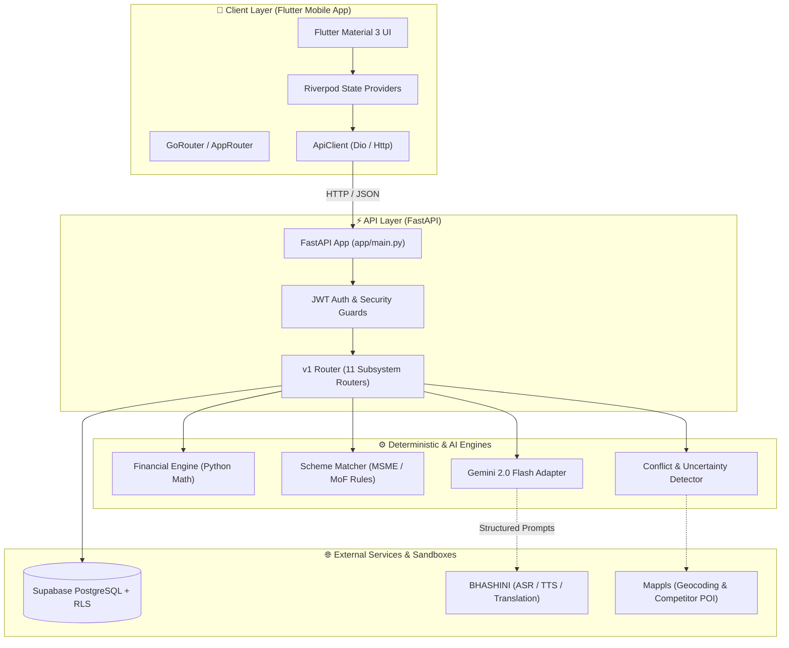

# 🤝 VYAPAR MITRA (व्यापार मित्र) — Developer Handoff & Teammate Playbook

**Target Audience:** Core Engineering Team, Incoming Contributors, and Hackathon Maintainers  
**Repository:** `S-H-R-I-A-N-S-H/VYAPAR-MITRA`  
**Problem Statement:** Smart India Hackathon (SIH) — ID: 26091  
**Last Updated:** September 2026  

---

## 📑 Table of Contents

1. [Executive Summary & Architectural Mental Model](#1-executive-summary--architectural-mental-model)
2. [Teammate Local Environment Setup Playbook](#2-teammate-local-environment-setup-playbook)
3. [Android Device Execution & Testing Guide (Crucial for Mobile Devs)](#3-android-device-execution--testing-guide-crucial-for-mobile-devs)
4. [Codebase Inventory & Subsystem Tour](#4-codebase-inventory--subsystem-tour)
5. [Testing & Quality Assurance Protocols](#5-testing--quality-assurance-protocols)
6. [Security, Authentication & Environment Configuration](#6-security-authentication--environment-configuration)
7. [The Teammate Compass: Completed, Working, Missing & Next Steps](#7-the-teammate-compass-completed-working-missing--next-steps)
   - [7.1 What All We Did Till Now](#71-what-all-we-did-till-now)
   - [7.3 What Is Missing / Mocked (The Major Remaining Chunk)](#73-what-is-missing--mocked-the-major-remaining-chunk)
   - [7.4 Teammate Action Plan & Next Sprints](#74-teammate-action-plan--next-sprints)
8. [Troubleshooting & Gotchas Cheatsheet](#8-troubleshooting--gotchas-cheatsheet)

---

## 1. Executive Summary & Architectural Mental Model

### 1.1 The Mission
India has over 63 million micro-enterprises, yet **over 80% of rural micro-enterprises fail within 3 years**. The root causes are systemic: lack of ground-truth validation, reliance on predatory moneylenders, underutilization of government subsidies (PMEGP, MUDRA), and generic AI chatbots that hallucinate business plans detached from rural Indian realities.

**Vyapar Mitra** is a full-lifecycle evidence-based advisory and smart financing companion. It combines hyper-local secondary research, entrepreneur-led primary market field surveys, deterministic financial feasibility calculations, rules-based scheme matching, and multilingual voice interaction.

### 1.2 The Cardinal Architectural Rule: Deterministic vs. AI Separation

```
   ❌ GENERIC CHATBOT PITFALL (Strictly Forbidden)
   User Prompt ──▶ Large Language Model ──▶ Hallucinated Financials & Untraceable Advice
   
   ✅ VYAPAR MITRA EVIDENCE ENGINE (Implemented Standard)
   User Profile + Locality 
          │
          ▼
   Secondary Research + Primary Ground Surveys ──▶ Evidence Reconciliation (Conflict Detection)
                                                            │
   Deterministic Financial Engine ◀─────────────────────────┘
   (Capex, Working Cap, EMI, DSCR via Python Math)
          │
   Deterministic Scheme Matcher (PMEGP, MUDRA rules)
          │
          ▼
   AI Synthesis (Gemini 2.0 Flash used ONLY for natural language explanation & formatting)
```

> [!IMPORTANT]
> **Non-Negotiable Rule for Contributors:**  
> **NEVER ask Gemini or any LLM to calculate loan EMIs, subsidy percentages, break-even months, or debt service coverage ratios.** All financial and scheme calculations MUST be executed by [financial_engine.py](file:///c:/VM/backend/app/services/financial_engine.py) and [scheme_matcher.py](file:///c:/VM/backend/app/services/scheme_matcher.py). Gemini's sole responsibility is translating and phrasing structured results into compassionate, clear regional language advice.

### 1.3 High-Level System Architecture



---

## 2. Teammate Local Environment Setup Playbook

You can run and develop the entire Vyapar Mitra platform locally **without needing paid API keys**. The backend includes automatic mock/sandbox fallbacks for Bhashini and Mappls.

### 2.1 Prerequisites
Ensure the following tools are installed on your machine:
- **Python 3.11 or 3.12** (`python --version`)
- **Flutter SDK 3.13+** with **Dart 3.1+** (`flutter --version`)
- **Android Studio** (with Android SDK Platform-Tools & Command-line Tools)
- **Git**

---

### 2.2 Step-by-Step Backend Setup (FastAPI)

#### 1. Navigate to the backend directory:
```bash
cd backend
```

#### 2. Create and activate a Python virtual environment:
- **On Windows (PowerShell):**
  ```powershell
  python -m venv .venv
  # If PowerShell blocks script execution, run: Set-ExecutionPolicy -Scope Process -ExecutionPolicy Bypass
  .\.venv\Scripts\Activate.ps1
  ```
- **On macOS / Linux:**
  ```bash
  python3 -m venv .venv
  source .venv/bin/activate
  ```

#### 3. Install dependencies:
```bash
pip install --upgrade pip
pip install -r requirements.txt
```

#### 4. Configure Environment Variables:
Copy the template in the root directory:
```bash
# From workspace root (c:\VM)
cp .env.example .env
```
Default parameters in `.env` are ready for development:
```dotenv
ENVIRONMENT=development
PORT=8000
HOST=0.0.0.0
# Optional keys: if left blank, backend runs in local sandbox/mock mode!
GEMINI_API_KEY=
BHASHINI_API_KEY=
MAPPLS_CLIENT_ID=
```

#### 5. Launch the FastAPI server:
```bash
uvicorn app.main:app --reload --host 0.0.0.0 --port 8000
```
- **Interactive Swagger Docs:** [http://localhost:8000/docs](http://localhost:8000/docs)
- **Health Check:** [http://localhost:8000/api/v1/health](http://localhost:8000/api/v1/health)

---

### 2.3 Step-by-Step Frontend Setup (Flutter)

#### 1. Open a new terminal in the project root:
```bash
cd c:\VM
```

#### 2. Install Flutter packages:
```bash
flutter pub get
```

#### 3. Verify Flutter environment:
```bash
flutter doctor
```
*(Ensure Android toolchain has green checkmarks. Run `flutter doctor --android-licenses` if prompted).*

---

## 3. Android Device Execution & Testing Guide (Crucial for Mobile Devs)

When running Flutter on Android, **`localhost` or `127.0.0.1` inside the Android app refers to the phone itself, NOT your development computer!** Follow one of the three verified methods below to connect your Android device to your local FastAPI backend.

### Method A: Physical Android Phone via USB (Recommended & Fastest)

This is the most reliable setup for testing voice and responsive UI.

1. Enable **Developer Options** and **USB Debugging** on your Android phone.
2. Connect the phone to your laptop via USB. Confirm the authorization popup on the phone.
3. Verify your device is recognized:
   ```bash
   adb devices
   ```
4. **Run ADB Reverse (The Golden Command):**
   ```bash
   adb reverse tcp:8000 tcp:8000
   ```
   > **What this does:** Any HTTP request from your Android phone to `http://127.0.0.1:8000` is transparently forwarded over USB directly to port 8000 on your development PC!
5. Launch the Flutter app:
   ```bash
   flutter run -d <your-device-id>
   ```

---

### Method B: Android Studio Emulator

The Android emulator runs inside a virtual network where your host machine is mapped to IP `10.0.2.2`.

1. Start your Android Emulator from Android Studio Device Manager.
2. Launch the Flutter app pointing to the emulator host alias:
   ```bash
   flutter run -d emulator-5554 --dart-define=API_BASE_URL=http://10.0.2.2:8000/api/v1
   ```
   *(Or run `adb reverse tcp:8000 tcp:8000` on the emulator and run standard `flutter run`).*

---

### Method C: Physical Android Phone over Local Wi-Fi (No USB Cable)

If you need to test wirelessly around the room:

1. Ensure both your PC and Android phone are on the **exact same Wi-Fi network**.
2. Find your PC's local LAN IP address:
   - **Windows:** Run `ipconfig` (Look for *IPv4 Address* under Wi-Fi, e.g., `192.168.1.45`).
   - **macOS / Linux:** Run `ifconfig` or `ip a`.
3. Verify your PC firewall allows incoming connections on port 8000.
4. Launch the Flutter app with the LAN IP override:
   ```bash
   flutter run --dart-define=API_BASE_URL=http://192.168.1.45:8000/api/v1
   ```

---

### ⚠️ Critical Android Gotcha: Cleartext HTTP Traffic

Android 9+ (API Level 28+) blocks unencrypted HTTP traffic by default. If your backend is running over plain HTTP (`http://...`), Android will throw:
```text
java.io.IOException: Cleartext HTTP traffic to 127.0.0.1 not permitted
```

**How to verify / fix:**  
In [android/app/src/main/AndroidManifest.xml](file:///c:/VM/android/app/src/main/AndroidManifest.xml), verify that `usesCleartextTraffic` and `INTERNET` permission are declared:

```xml
<manifest xmlns:android="http://schemas.android.com/apk/res/android">
    <!-- Required for network requests -->
    <uses-permission android:name="android.permission.INTERNET"/>
    <uses-permission android:name="android.permission.ACCESS_NETWORK_STATE"/>
    <!-- Required for future voice recording -->
    <uses-permission android:name="android.permission.RECORD_AUDIO"/>

    <application
        android:label="vyapar_mitra"
        android:name="${applicationName}"
        android:icon="@mipmap/ic_launcher"
        android:usesCleartextTraffic="true">
        ...
    </application>
</manifest>
```

---

### 3.4 Building an Android APK for Field Testing

To generate a standalone release or debug APK for team testing:

```bash
# Build debug APK (installs on any phone without signing keys):
flutter build apk --debug

# The generated APK will be located at:
# build/app/outputs/flutter-apk/app-debug.apk
```
Install directly onto a connected phone:
```bash
adb install -r build/app/outputs/flutter-apk/app-debug.apk
```

---

## 4. Codebase Inventory & Subsystem Tour

### 4.1 Backend Architecture (`c:\VM\backend\app`)

| Directory / File | Type | Purpose & Responsibility |
| :--- | :--- | :--- |
| [main.py](file:///c:/VM/backend/app/main.py) | Entry Point | FastAPI initialization, CORS configuration, error handlers, and lifecycle hooks. |
| [core/config.py](file:///c:/VM/backend/app/core/config.py) | Config | Pydantic Settings parsing `.env` file for server, database, and API keys. |
| [core/security.py](file:///c:/VM/backend/app/core/security.py) | Security | JWT token parsing, signature verification, and user authorization dependencies. |
| [api/v1/router.py](file:///c:/VM/backend/app/api/v1/router.py) | Router | Master API router prefixing all subsystem endpoints under `/api/v1`. |
| [api/v1/endpoints/health.py](file:///c:/VM/backend/app/api/v1/endpoints/health.py) | Endpoint | Server health checks and subsystem status reporting. |
| [api/v1/endpoints/finance.py](file:///c:/VM/backend/app/api/v1/endpoints/finance.py) | Endpoint | Financial simulation, what-if sensitivity analysis, and scenario management. |
| [api/v1/endpoints/schemes.py](file:///c:/VM/backend/app/api/v1/endpoints/schemes.py) | Endpoint | Government schemes catalog and rules-based matching. |
| [api/v1/endpoints/research.py](file:///c:/VM/backend/app/api/v1/endpoints/research.py) | Endpoint | Secondary research hypothesis generation and uncertainty tracking. |
| [api/v1/endpoints/surveys.py](file:///c:/VM/backend/app/api/v1/endpoints/surveys.py) | Endpoint | 3-question field survey generation and primary response ingestion. |
| [api/v1/endpoints/evidence.py](file:///c:/VM/backend/app/api/v1/endpoints/evidence.py) | Endpoint | Conflict detection between secondary research and ground evidence. |
| [services/financial_engine.py](file:///c:/VM/backend/app/services/financial_engine.py) | Core Service | **Deterministic financial math**: Capex, Working Cap, Monthly EMI, DSCR, Break-Even. |
| [services/scheme_matcher.py](file:///c:/VM/backend/app/services/scheme_matcher.py) | Core Service | **Deterministic scheme rules**: PMEGP subsidy calculations, MUDRA tier qualification. |
| [services/conflict_detector.py](file:///c:/VM/backend/app/services/conflict_detector.py) | Core Service | Reconciles discrepancies between online estimates and field observations. |
| [services/opportunity_generator.py](file:///c:/VM/backend/app/services/opportunity_generator.py) | Core Service | Matches entrepreneur skills/capital/land to viable local businesses (State B). |
| [services/prompt_service.py](file:///c:/VM/backend/app/services/prompt_service.py) | Core Service | Structured Pydantic prompt construction for Gemini AI responses. |
| [adapters/gemini_adapter.py](file:///c:/VM/backend/app/adapters/gemini_adapter.py) | Adapter | Google Gemini 2.0 Flash integration with retry resilience and offline fallback. |
| [adapters/bhashini_adapter.py](file:///c:/VM/backend/app/adapters/bhashini_adapter.py) | Adapter | Bhashini translation & ASR adapter with mock sandbox fallback. |
| [adapters/mappls_adapter.py](file:///c:/VM/backend/app/adapters/mappls_adapter.py) | Adapter | Mappls MapmyIndia geocoding & competitor search with mock sandbox fallback. |
| [adapters/supabase_adapter.py](file:///c:/VM/backend/app/adapters/supabase_adapter.py) | Adapter | Supabase client manager supporting both anon and service-role execution. |

---

### 4.2 Frontend Architecture (`c:\VM\lib`)

| Directory / File | Purpose & Screen Navigation |
| :--- | :--- |
| [main.dart](file:///c:/VM/lib/main.dart) | Initializes Flutter binding, Riverpod `ProviderScope`, and boots `VyaparMitraApp`. |
| [app/router.dart](file:///c:/VM/lib/app/router.dart) | Named route generator for all 10 application screens. |
| [core/network/api_endpoints.dart](file:///c:/VM/lib/core/network/api_endpoints.dart) | Centralized API URLs supporting Android USB reverse (`127.0.0.1`) and CLI overrides. |
| [core/network/api_client.dart](file:///c:/VM/lib/core/network/api_client.dart) | HTTP client wrapper with unified error handling and timeout management. |
| [core/theme/app_colors.dart](file:///c:/VM/lib/core/theme/app_colors.dart) | High-contrast accessible color palette designed for bright sunlight visibility. |
| [features/onboarding/](file:///c:/VM/lib/features/onboarding/) | Language selection (Hindi, Marathi, English, etc.) and welcome screen. |
| [features/interview/](file:///c:/VM/lib/features/interview/) | Conversational voice/text interview screen with simulated typing and microphone actions. |
| [features/opportunities/](file:///c:/VM/lib/features/opportunities/) | State B: Curated hyperlocal opportunity cards with capital and risk tags. |
| [features/business/](file:///c:/VM/lib/features/business/) | Business model confirmation and parameter adjustments. |
| [features/research/](file:///c:/VM/lib/features/research/) | Secondary market research progress and automated hypothesis generation. |
| [features/validation/](file:///c:/VM/lib/features/validation/) | Primary survey checklist and conflict detection dashboard. |
| [features/finance/](file:///c:/VM/lib/features/finance/) | Financial scenario modeler, break-even graphs, and what-if sliders. |
| [features/recommendations/](file:///c:/VM/lib/features/recommendations/) | Final synthesized business viability report, action plan, and scheme badges. |

---

### 4.3 Database Architecture (`c:\VM\supabase\migrations`)

Located at [20260912000000_initial_schema.sql](file:///c:/VM/supabase/migrations/20260912000000_initial_schema.sql):
- **Core Tables:** `profiles`, `businesses`, `interviews`, `opportunities`, `research_projects`, `research_questions`, `field_surveys`, `survey_responses`, `conflict_logs`, `financial_scenarios`, `scheme_applications`.
- **Security:** Strict PostgreSQL Row Level Security (RLS) policies enforcing `auth.uid() = user_id`.

---

## 5. Testing & Quality Assurance Protocols

Vyapar Mitra adheres to strict **Test-Driven Development (TDD)**. All financial calculations, scheme eligibility algorithms, and API contracts must pass automated tests.

### 5.1 Running Backend Pytest Suites

Activate your virtual environment and run:

```bash
# Navigate to backend directory
cd backend

# Run all unit tests and API endpoint tests with verbose output:
pytest -v

# Run only deterministic financial engine unit tests:
pytest tests/unit/test_financial_engine.py -v

# Run only government scheme matcher tests:
pytest tests/unit/test_scheme_matcher.py -v

# Run only API endpoint integration tests:
pytest tests/api/ -v
```

#### What Backend Tests Validate:
1. **Financial Precision:** Verified mathematically against banking formulas (Standard reducing-balance EMI formula, DSCR, and Break-Even point).
2. **Scheme Boundaries:**
   - **PMEGP:** 15% vs 25% (Urban) and 25% vs 35% (Rural) subsidy caps, Special Category affirmative rules.
   - **MUDRA:** Exact tier allocation (Shishu $\le$ ₹50,000, Kishore $\le$ ₹5,00,000, Tarun $\le$ ₹10,00,000).
   - **PM SVANidhi:** Nano-credit tiering starting at ₹10,000.
3. **Conflict Detection:** Identifies discrepancies when ground milk procurement price ($42/L) exceeds secondary research estimate ($32/L).

---

### 5.2 Running Flutter Tests & Static Analysis

From the workspace root:

```bash
# 1. Run static Dart analyzer (must have 0 errors):
flutter analyze --no-fatal-infos

# 2. Run automated Flutter widget and unit tests:
flutter test
```

---

## 6. Security, Authentication & Environment Configuration

### 6.1 Secret Governance (Zero-Secret Policy)
- **NEVER** commit API keys, service role tokens, or passwords to git.
- The `.env` file is explicitly ignored in [.gitignore](file:///c:/VM/.gitignore).
- When adding new environment variables, update [.env.example](file:///c:/VM/.env.example) with placeholder values and descriptive comments.

### 6.2 Authentication & Authorization Boundaries
1. **Client Identity:** In full deployment, Flutter authenticates with Supabase Auth (via mobile phone OTP) and receives a signed JWT.
2. **Server Enforcement:** Every API request transmits the JWT in the `Authorization: Bearer <token>` header.
3. **Middleware Guard:** [core/security.py](file:///c:/VM/backend/app/core/security.py) decodes the JWT using `SUPABASE_JWT_SECRET` and extracts `current_user["id"]`.
4. **Development Authentication Guard:** In development mode (`ENVIRONMENT=development`), [core/security.py](file:///c:/VM/backend/app/core/security.py) strictly verifies that an `Authorization` header is present. If the header is missing, FastAPI returns HTTP 401 Unauthorized (`Missing Authorization header`). When a development Bearer token (such as `mock-user-dev-001` or matching `mock-user-*`) is passed, `get_current_user` injects the development test user (`dev-test-user-001`). The Flutter client automatically manages this via `authProvider`, providing seamless authenticated calls out-of-the-box in local development.

---

## 7. The Teammate Compass: Completed, Working, Missing & Next Steps

This is the most critical section for the team. It provides complete transparency regarding what was built, what can be demonstrated immediately, what is mocked, and the major remaining chunk of work.

### 7.1 What All We Did Till Now

We have established the complete architectural backbone, deterministic domain engines, REST API layer, Flutter screen flows, and documentation suite:

1. **Complete FastAPI Backend Skeleton:**
   - Configured 11 modular endpoint groups under `/api/v1`.
   - Built deterministic mathematical services for Capex, Working Capital, EMI, DSCR, and Scheme Matching.
   - Built conflict detection logic to reconcile survey data with secondary market data.
2. **Robust Test Suite (19 Backend Test Modules + 22 Flutter Test Suites):**
   - 7 unit test suites covering all business logic engines.
   - 10 API route test suites verifying HTTP status codes and Pydantic validation.
   - 22 Flutter unit, widget, and integration tests verifying client lifecycle, token propagation, profile contract adherence, and screen flows.
3. **Flutter Material 3 Mobile Application:**
   - 10 structured feature modules and screens covering the entire user journey.
   - High-contrast, accessible rural theme palette.
   - Configured centralized networking layer with adaptive Android IP handling and active JWT injection.
4. **Database & Schema Design:**
   - Comprehensive PostgreSQL migration with 11 relational tables and Row Level Security policies.
5. **Exhaustive Documentation Suite (`docs/`):**
   - 10 authoritative specification documents covering Product, Architecture, API Contracts, Database, AI Prompting, Security, UX, Testing, and Development.
6. **Task 1 Backend Foundation (Complete & Frozen):**
   - Implemented and committed on branch `financial-calculator` (`feat(backend): implement profile-to-business foundation`).
   - Architectural chain established:
     ```
     Authenticated User ──▶ Entrepreneur Profile (id) ──▶ Business (real business_id)
     ```
   - Endpoints updated: [profile.py](file:///c:/VM/backend/app/api/v1/endpoints/profile.py), [businesses.py](file:///c:/VM/backend/app/api/v1/endpoints/businesses.py), and [opportunities.py](file:///c:/VM/backend/app/api/v1/endpoints/opportunities.py).
   - Verified with backend pytest suites.
7. **Phase 1: Frontend Authentication & Token Propagation (Complete & Verified):**
   - Created `lib/core/auth/auth_state.dart` and `lib/core/auth/auth_notifier.dart`.
   - Connected `authProvider` to `apiClientProvider` to dynamically pass the active token via `Authorization: Bearer <token>`.
   - Initialized default development token `mock-user-dev-001` matching backend dev authentication requirements.
   - Verified resolution of the previous HTTP 401 Unauthorized (`Missing Authorization header`) error with 7 dedicated automated tests.
8. **Phase 2: Profile Contract Alignment & Persistence (Complete & Verified):**
   - Aligned Flutter `BusinessProfileScreen` request body with backend `EntrepreneurProfileCreate` Pydantic schema in [schemas/profile.py](file:///c:/VM/backend/app/schemas/profile.py):
     - Formed nested `LocationCreate` object: `state`, `district`, `town_or_village` (mapped from form block).
     - Aligned field naming: `preferred_language` (from `localeProvider`), `available_capital`, `voice_enabled: true`.
     - Structured skills and interests as typed lists: `skills: ['machinery']`, `interests: []`.
     - Included affirmative action parameters: `scheme_category` (from form) and `consent_recorded: true`.
     - Removed legacy flat/deprecated fields (`phone_number`, `education_level`, `primary_skill`, `primary_language`).
   - Replaced hardcoded URL `http://127.0.0.1:8000/api/v1/profile` with centralized [ApiEndpoints.profile](file:///c:/VM/lib/core/network/api_endpoints.dart).
   - Extracted server-assigned entrepreneur profile UUID (`data.id`) from the HTTP 201 response and stored it into Riverpod via `businessProfileProvider.notifier.setProfileId(profileId)`.
   - Removed silent error swallowing: added error SnackBar feedback (`Failed to save profile: $e`), preserving user inputs on error and preventing unintended screen transition.
   - Added automated integration tests in [test/features/profile_integration_test.dart](file:///c:/VM/test/features/profile_integration_test.dart) (3/3 passing), bringing the Flutter test suite to 22/22 passing.
9. **Phase 3: Business Creation & Real `business_id` Propagation (Complete & Verified):**
   - Implemented real business creation from the Mobile Business Confirmation Checkpoint (`BusinessConfirmationScreen`).
   - Replaced static/local-only status transition with live API call to `POST /api/v1/businesses` using centralized [ApiEndpoints.businesses](file:///c:/VM/lib/core/network/api_endpoints.dart).
   - Formed outbound payload conforming strictly to backend `BusinessCreate` schema:
     - `name`: `business.title`
     - `domain`: `business.domain`
     - `product_or_service`: `business.title`
     - `business_model`: `'Direct retail & local haat distribution'`
     - `description`: `'${business.title} located in ${profile.block}, ${profile.district}'`
     - `target_customer`: localized customer description
     - `intended_market`: `'${profile.block} Block, ${profile.district} (~10 km radius)'`
     - `scale`: `'micro'`
   - Leveraged authenticated `apiClientProvider` transmitting active Bearer token (`mock-user-dev-001` in development).
   - Verified profile dependency: verifies `profile.profileId` exists from Phase 2; halts and alerts user if profile is missing.
   - On HTTP 201 Created response, extracted server-assigned business UUID (`res['data']['id']`) and persisted it into Riverpod via `selectedBusinessProvider.notifier.setBusinessId(serverBusinessId)`.
   - Built duplicate prevention: checks if `business.businessId` is already set before making network call, preventing duplicate creation upon screen re-entry.
   - Robust error handling: displays error SnackBar and stays on screen without updating state or navigating on failure.
   - Automated tests: created [test/features/business_creation_integration_test.dart](file:///c:/VM/test/features/business_creation_integration_test.dart) (5/5 passing). Full Flutter test suite expanded to 27/27 passing.
   - Real backend verification performed against live port 8000: verified `OPTIONS /businesses` → 200, `POST /profile` → 201 (`profileId: 3507cde8-320d-46b5-9122-2256a2dba260`), and `POST /businesses` → 201 (`business_id: eb7050a5-e245-4dd4-8bba-8307ce78c27c` with `entrepreneur_id` correctly referencing `profileId`).

### 7.2 Integration Phase Status Summary

| Phase | Description | Status | Verification & Evidence |
|---|---|---|---|
| **Task 1 Backend** | Profile → Business Foundation (`user_id` → `profile_id` → `business_id`) | **COMPLETE (Frozen)** | Backend pytest suite passes; committed on branch `financial-calculator` |
| **Phase 1** | Frontend Auth & Token Propagation (`authProvider` → `apiClientProvider`) | **COMPLETE** | 7 automated tests pass (`test/core/auth_integration_test.dart`); HTTP 401 resolved |
| **Phase 2** | Profile Contract Alignment & State Persistence (`EntrepreneurProfileCreate` → `setProfileId`) | **COMPLETE** | 3 integration tests pass (`test/features/profile_integration_test.dart`); HTTP 422 resolved |
| **Phase 3** | Business Creation & Real `business_id` Propagation | **COMPLETE** | 5 integration tests pass (`test/features/business_creation_integration_test.dart`); all 27 Flutter tests pass; live backend verified (OPTIONS 200, POST 201) |
| **Phase 4** | Financial Engine & Scenario Integration | **NOT STARTED** | Next to execute |

---

### 7.3 What Is Missing / Mocked (The Major Remaining Chunk)

> [!WARNING]
> **Attention Teammates:** While the architectural foundations and deterministic mathematical engines are complete, **a major chunk of live production integrations remains to be completed**. Do not assume external services are live.

Here is the exact breakdown of what is currently mocked or incomplete:

#### 1. External Live Integrations (Currently Using Mock/Sandbox Fallbacks)
- **BHASHINI Speech & Translation Pipeline:**
  - *Current Status:* [adapters/bhashini_adapter.py](file:///c:/VM/backend/app/adapters/bhashini_adapter.py) returns dummy Hindi prefix strings `[हिंदी अनुवाद]` and a hardcoded sample transcription.
  - *What Needs to be Done:* Connect to live Bhashini ULCA APIs (pipeline config, ASR compute endpoint, NMT translation, and TTS audio synthesis).
- **Mappls (MapmyIndia) Geospatial Intelligence:**
  - *Current Status:* [adapters/mappls_adapter.py](file:///c:/VM/backend/app/adapters/mappls_adapter.py) returns hardcoded coordinates for Pune and dummy competitors ("Krishna Dairy").
  - *What Needs to be Done:* Implement real OAuth 2.0 token handshake (`outpost.mappls.com/api/security/oauth/token`) and query live Nearby POI APIs for actual competitor counts in the user's village.
- **Google Gemini 2.0 Generative AI:**
  - *Current Status:* [adapters/gemini_adapter.py](file:///c:/VM/backend/app/adapters/gemini_adapter.py) is implemented, but if `GEMINI_API_KEY` is not provided in `.env`, it returns fallback placeholder strings.
  - *What Needs to be Done:* Supply an active Gemini API key and test dynamic prompt chaining for real-time natural language explanations.

#### 2. Cloud Database Persistence vs In-Memory Stubs
- *Current Status:* Endpoints fall back to in-memory dictionaries when Supabase is unreachable. If you restart the server, in-memory data resets!
- *What Needs to be Done:* Link a real hosted Supabase project, execute `supabase db push` or run [20260912000000_initial_schema.sql](file:///c:/VM/supabase/migrations/20260912000000_initial_schema.sql), and test end-to-end persistent data storage across server reboots.

#### 3. Mobile Hardware & Native Capabilities (Android)
- *Current Status:* The Flutter conversational interview screen shows microphone buttons, but does **not yet capture raw microphone audio from the phone**.
- *What Needs to be Done:* Add a native recording package (e.g. `record` or `flutter_sound`), capture `.wav`/`.m4a` audio bytes on the Android device, and stream them to the backend speech endpoint.
- *Current Status:* No offline SQLite/Hive database on the phone. If the entrepreneur is in an area with zero cellular connectivity, survey data is not persisted locally.
- *What Needs to be Done:* Add local storage (`drift` or `hive`) to store offline survey responses and sync when connectivity resumes.

#### 4. Post-Launch Features & Exporters
- *Missing:* Exporting business viability reports and pre-filled PMEGP / MUDRA application summaries to downloadable **PDF files**.
- *Missing:* Post-launch daily ledger tracking (Milestone tracking logbook).

---

### 7.4 Teammate Action Plan & Next Sprints

To divide work effectively among the team, pick tasks from the prioritized sprint backlog below:

```
┌────────────────────────────────────────────────────────────────────────┐
│                        TEAM SPRINT ROADMAP                             │
├──────────────────┬──────────────────┬──────────────────┬───────────────┤
│     SPRINT 1     │     SPRINT 2     │     SPRINT 3     │   FINAL POLISH│
│  Live Services & │  Android Voice & │ Offline Storage &│ Field Demo &  │
│ Cloud DB Sync    │ Microphone Stream│ PDF Exporters    │ Presentation  │
└──────────────────┴──────────────────┴──────────────────┴───────────────┘
```

#### Sprint 1: Live Cloud Database & External API Handshakes
- **Teammate A (Backend / Supabase):**
  - Create free hosted Supabase project.
  - Apply [20260912000000_initial_schema.sql](file:///c:/VM/supabase/migrations/20260912000000_initial_schema.sql).
  - Populate `.env` with real `SUPABASE_URL` and `SUPABASE_SERVICE_ROLE_KEY`.
  - Validate that creating a business or scenario persists in Postgres and survives server restarts.
- **Teammate B (Backend / Mappls & Gemini):**
  - Sign up on Mappls developer portal and obtain Client ID & Secret.
  - Complete live token exchange and nearby search in `mappls_adapter.py`.
  - Add real `GEMINI_API_KEY` to `.env` and verify dynamic conversational advice.

#### Sprint 2: Android Native Audio & Live Speech-to-Text
- **Teammate C (Mobile / Voice Integration):**
  - Integrate `record` package in Flutter.
  - Request runtime `RECORD_AUDIO` permission on Android.
  - Transmit recorded voice bytes to backend `/api/v1/interviews/{id}/messages`.
- **Teammate D (Backend / Bhashini):**
  - Register on Bhashini API portal.
  - Implement ULCA pipeline API call in `bhashini_adapter.py` for real Hindi/Marathi speech recognition.

#### Sprint 3: Offline Caching & PDF Document Generation
- **Teammate E (Mobile / Offline Sync):**
  - Set up `hive` or `shared_preferences` in Flutter to save survey questions offline.
  - Allow entrepreneurs to fill survey questions without cellular connectivity.
- **Teammate F (Fullstack / Loan Exporter):**
  - Add backend endpoint generating a formatted PDF business plan using `reportlab` or Flutter `pdf` package.
  - Include deterministic loan amortization schedule and PMEGP subsidy eligibility certificate.

---

## 8. Troubleshooting & Gotchas Cheatsheet

### 1. `Connection Refused` on Android Device
- **Cause:** Android app is trying to connect to `http://localhost:8000`, which refers to the phone, not your computer.
- **Fix:** If connected via USB, run:
  ```bash
  adb reverse tcp:8000 tcp:8000
  ```
  If on Wi-Fi, run with your computer's LAN IP:
  ```bash
  flutter run --dart-define=API_BASE_URL=http://<YOUR_PC_IP>:8000/api/v1
  ```

### 2. `Cleartext HTTP traffic not permitted`
- **Cause:** Android blocks non-HTTPS traffic by default.
- **Fix:** Ensure `android:usesCleartextTraffic="true"` is set inside `<application>` in [android/app/src/main/AndroidManifest.xml](file:///c:/VM/android/app/src/main/AndroidManifest.xml).

### 3. PowerShell Execution Policy Error on Windows
- **Error:** `File Activate.ps1 cannot be loaded because running scripts is disabled on this system.`
- **Fix:** In your PowerShell terminal, run:
  ```powershell
  Set-ExecutionPolicy -Scope Process -ExecutionPolicy Bypass
  .\.venv\Scripts\Activate.ps1
  ```

### 4. Port 8000 Already in Use
- **Error:** `[Errno 10048] error while attempting to bind on address ('0.0.0.0', 8000)`
- **Fix:**
  - Windows: Run `netstat -ano | findstr :8000` to find the PID, then `taskkill /PID <PID> /F`.
  - Alternatively, start FastAPI on port 8001: `uvicorn app.main:app --port 8001 --reload` (and pass `--dart-define=API_BASE_URL=http://127.0.0.1:8001/api/v1` to Flutter).

### 5. Backend Returns Mock Data Instead of Real API Results
- **Cause:** Missing API credentials in `.env`.
- **Behavior:** This is normal and intentional! The backend is designed to degrade gracefully to sandbox mode so you are never blocked from developing UI or testing business logic.

---

## 📞 Key Contacts & Documentation References

- **Full Product Definition:** [`docs/product.md`](file:///c:/VM/docs/product.md)
- **Technical Architecture:** [`docs/architecture.md`](file:///c:/VM/docs/architecture.md)
- **API Contracts:** [`docs/api-contracts.md`](file:///c:/VM/docs/api-contracts.md)
- **Database Schema:** [`docs/database.md`](file:///c:/VM/docs/database.md)
- **Testing Playbook:** [`docs/testing.md`](file:///c:/VM/docs/testing.md)
- **UX & Voice Guidelines:** [`docs/ux.md`](file:///c:/VM/docs/ux.md)
- **Development Workflow:** [`docs/development.md`](file:///c:/VM/docs/development.md)

*Welcome to the team! Build with ground-truth evidence, keep calculations deterministic, and empower India's rural entrepreneurs.* 🌾
