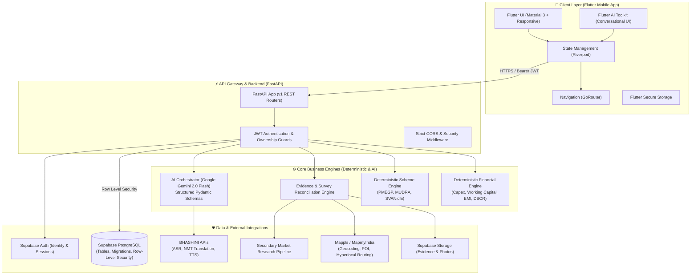
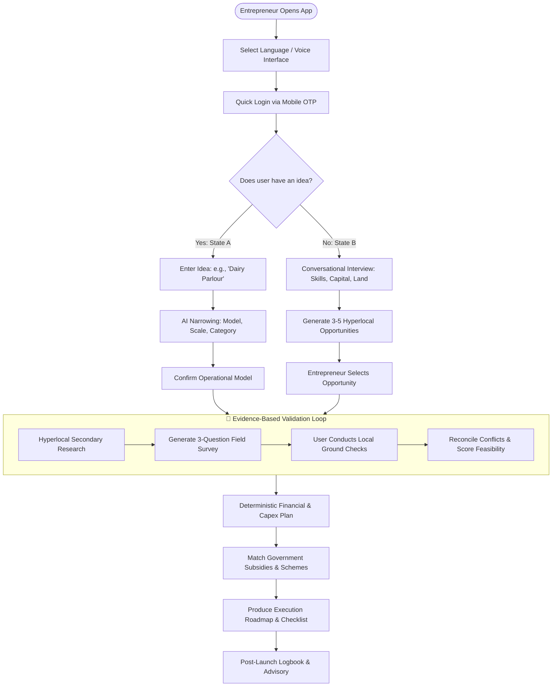

<div align="center">

# 🌾 VYAPAR MITRA (व्यापार मित्र)
### Full-Lifecycle Evidence-Based Advisory & Smart Financing for Rural Micro-Entrepreneurs

**Smart India Hackathon (SIH) — Problem Statement ID: 26091**

[](https://flutter.dev)
[](https://fastapi.tiangolo.com)
[](https://www.python.org)
[](https://supabase.com)
[](https://deepmind.google/technologies/gemini/)
[](https://bhashini.gov.in)
[](https://www.mappls.com)
[](https://opensource.org/licenses/MIT)

<p align="center">
  <a href="#-quick-links">Quick Links</a> •
  <a href="#-the-problem--core-philosophy">Philosophy</a> •
  <a href="#-key-features">Key Features</a> •
  <a href="#-system-architecture">Architecture</a> •
  <a href="#-user-journeys">User Journeys</a> •
  <a href="#-repository-structure">Repository</a> •
  <a href="#-getting-started">Quickstart</a> •
  <a href="#-testing">Testing</a> •
  <a href="#-documentation-index">Docs</a>
</p>

---

</div>

## 🔗 Quick Links

| Resource | Link | Description |
| :--- | :--- | :--- |
| 📱 **Mobile APK** | [Download Release APK](https://github.com/S-H-R-I-A-N-S-H/VYAPAR-MITRA/releases/latest) | Latest Android build for field trials |
| 🎬 **Video Walkthrough** | [Watch 3-Minute Demo Video](https://youtu.be/placeholder-vm-demo) | Comprehensive walkthrough of rural user onboarding & validation |
| 📊 **Pitch Deck** | [View SIH Presentation Deck (PDF)](./docs/presentation/SIH_26091_VyaparMitra_Deck.pdf) | Executive deck covering business model, technology & rural impact |
| 📑 **API Documentation** | [Swagger / OpenAPI Docs](http://localhost:8000/docs) | Interactive API exploration running on local FastAPI server |

---

## 💡 The Problem & Core Philosophy

### The Rural Reality
India has over 63 million micro-enterprises, with tens of millions emerging across rural and semi-urban districts. Yet, **over 80% of rural micro-enterprises stall or fail within their first 3 years**. The root causes are systemic:
- **No Ground Validation**: Founders rely on hearsay rather than localized market dynamics, competitor densities, and local input availability.
- **Financial Illiteracy & Debt Traps**: Lack of understanding regarding initial capex vs. working capital, leading to reliance on unorganized moneylenders at extortionate rates.
- **Underutilization of Government Schemes**: Flagship schemes like PMEGP, Mudra, and Stand-Up India remain inaccessible due to opaque eligibility criteria and documentation hurdles.
- **The Generic AI Pitfall**: Generic LLM chatbots hallucinate generic business plans based on broad Internet data that collapse when deployed in an Indian village.

### The Vyapar Mitra Principle: Ground-Truth Evidence, Not Chatbot Hallucinations

```
   ❌ GENERIC CHATBOT APPROACH
   User Prompt ──▶ Large Language Model ──▶ Unverified, Hallucinated Business Report
   
   ✅ VYAPAR MITRA EVIDENCE ENGINE
   Entrepreneur Profile
          +
   Hyperlocal Research ──▶ Primary Ground Surveys ──▶ Evidence Reconciliation
                                                               │
   Deterministic Financial Engine ◀────────────────────────────┘
          +
   Rules-Based Scheme Matcher ──▶ Explainable, Traceable Recommendations
```

Vyapar Mitra **strictly separates deterministic computations from AI reasoning**:
1. **Mathematical certainty**: Loan EMIs, debt-service coverage ratios (DSCR), break-even timelines, and working capital needs are calculated using deterministic code, never LLM output.
2. **Transparent scheme eligibility**: Government scheme matching is driven by deterministic rule engines conforming to official MSME/MoF guidelines.
3. **Reconciled evidence**: When secondary Internet research conflicts with the entrepreneur's ground observations (e.g., local milk procurement prices), the system flags the contradiction and guides the entrepreneur to verify it before risking capital.

---

## ✨ Key Features

### 🎙️ 1. Multilingual Voice & Conversational Onboarding
- Powered by **BHASHINI** (National Language Translation Mission) and **Flutter AI Toolkit**.
- Full voice-in, voice-out interaction in regional Indian languages (Hindi, Marathi, Tamil, Telugu, Bengali, Kannada, and more).
- Tailored for low-literacy users through intuitive conversational prompts rather than intimidating corporate forms.

### 🧭 2. Dual Starting States
- **State A (Specific Idea)**: Narrow down broad concepts into executable business models (e.g., transforming *"I want to start a dairy business"* into *"500 L/day village chilling center serving 12 local dairy farmers"*).
- **State B (Opportunity Discovery)**: Hyperlocal opportunity discovery matching the entrepreneur's capital, available land/assets, technical skills, and local market demand.

### 🗺️ 3. Hyperlocal Research & Ground Surveys
- Integration with **Mappls (MapmyIndia)** geospatial APIs to assess competitor density, road connectivity, nearest mandis/APMCs, and raw material clusters.
- Generates tailored, 3-question field survey checklists for the entrepreneur to interview local suppliers, buyers, and competitors.

### ⚖️ 4. Evidence Reconciliation Engine
- Detects discrepancies between secondary online estimates and primary field observations.
- Surfaces actionable confidence scores (High, Medium, Critical Risk) with transparent justification.

### 💰 5. Deterministic Financial Planning & Scheme Matching
- **Financial Feasibility**: Automatic computation of Capex, Working Capital, Monthly Operating Expenses, Gross Margin, and Break-Even Point.
- **Scheme Matching**: Real-time evaluation against eligibility rules for:
  - **PMEGP** (Prime Minister's Employment Generation Programme — subsidies up to 35%)
  - **Pradhan Mantri MUDRA Yojana** (Shishu, Kishore, Tarun tiers)
  - **Stand-Up India** (SC/ST and Women entrepreneurs)
  - **PM SVANidhi** (Micro-credit for street vendors and nano-enterprises)

### 📈 6. Continuous Logbook & Adaptive Guidance
- Post-launch milestone tracking, daily ledger logging, and adaptive notifications when input costs surge or working capital dips below safety thresholds.

---

## 🏗️ System Architecture

Vyapar Mitra uses a clean, layered architecture ensuring robust separation of concerns, high testability, and enterprise-grade security.



---

## 🛤️ User Journeys



---

## 📂 Repository Structure

```text
vyapar-mitra/
├── lib/                             # 📱 Flutter Mobile Application Root
│   ├── main.dart                    # Application entry point
│   ├── app/                         # App configuration, routing & lifecycle
│   ├── core/                        # Theme, typography, constants & network client
│   │   ├── theme/                   # High-contrast, accessible rural color palette
│   │   └── utils/                   # Shared formatters (INR currency, dates)
│   ├── features/                    # Feature modules (Domain-driven architecture)
│   │   ├── onboarding/              # Language selection & phone auth
│   │   ├── interview/               # Conversational voice/text interview
│   │   ├── opportunities/           # State B: Opportunity discovery
│   │   ├── business/                # Business model management & state
│   │   ├── research/                # Secondary market intelligence
│   │   ├── evidence/                # Primary ground surveys & reconciliation
│   │   ├── finance/                 # Financial feasibility & calculator views
│   │   ├── recommendations/         # Traceable advice & action roadmap
│   │   └── profile/                 # Entrepreneur profile & location preferences
│   └── shared/                      # Reusable widgets (cards, badges, dialogs)
│
├── backend/                         # ⚡ FastAPI Modular Monolith
│   ├── app/
│   │   ├── main.py                  # FastAPI application & middleware configuration
│   │   ├── core/                    # Config, security, database & error handlers
│   │   ├── schemas/                 # Strict Pydantic v2 validation models
│   │   ├── services/                # Business logic services
│   │   │   ├── financial_engine.py  # Deterministic financial computations
│   │   │   ├── scheme_engine.py     # Deterministic government scheme matcher
│   │   │   ├── evidence_service.py  # Research synthesis & reconciliation
│   │   │   └── ai_service.py        # Gemini AI structured orchestration
│   │   ├── adapters/                # Pluggable external adapters
│   │   │   ├── bhashini.py          # Bhashini ASR/TTS with sandbox fallback
│   │   │   └── mappls.py            # Mappls Geospatial with mock fallback
│   │   └── api/v1/                  # Versioned API routes
│   │       ├── endpoints/           # Clean modular route handlers
│   │       └── router.py            # Consolidated v1 router
│   ├── tests/                       # Pytest automated test suite
│   ├── requirements.txt             # Python dependencies
│   └── README.md                    # Dedicated backend documentation
│
├── supabase/                        # 🗄️ Database & Backend-as-a-Service
│   └── migrations/                  # Version-controlled SQL DDL & RLS policies
│
├── docs/                            # 📚 Comprehensive Architecture & Product Specs
│   ├── product.md                   # Product definition & SIH MVP requirements
│   ├── architecture.md              # Technical architecture & subsystem boundaries
│   ├── api-contracts.md             # REST API contracts & Pydantic schemas
│   ├── database.md                  # Relational schema & RLS security design
│   ├── ai-behaviour.md              # Prompt engineering, schemas & hallucination control
│   ├── security.md                  # Auth, secrets, sanitization & compliance
│   ├── ux.md                        # Multilingual, low-literacy UX guidelines
│   ├── testing.md                   # Automated testing strategy (backend + mobile)
│   ├── development.md               # Developer workflow, coding standards & CI
│   └── stitch-workflow.md           # Google Stitch UI design synthesis workflow
│
├── assets/                          # Static assets (i18n catalogs, icons, logos)
├── pubspec.yaml                     # Flutter dependency manifest
├── analysis_options.yaml            # Dart static analysis configuration
├── .env.example                     # Environment configuration template
└── README.md                        # This project presentation & developer guide
```

---

## 🚀 Getting Started

### Prerequisites

Ensure you have the following installed on your development machine:
- **Flutter SDK** (`^3.13.3` or later) & **Dart SDK** (`^3.1.0` or later) — [Install Flutter](https://docs.flutter.dev/get-started/install)
- **Python** (`3.11` or `3.12`) — [Install Python](https://www.python.org/downloads/)
- **Android Studio** or **VS Code** with Flutter & Dart extensions
- **Git**

---

### Step 1: Clone the Repository

```bash
git clone https://github.com/S-H-R-I-A-N-S-H/VYAPAR-MITRA.git
cd vyapar-mitra
```

---

### Step 2: Configure Environment Variables

Create your local `.env` configuration by copying the provided template:

```bash
# On Linux / macOS
cp .env.example .env

# On Windows (PowerShell)
Copy-Item .env.example .env
```

Open `.env` in your editor and configure:

| Key | Required | Default / Fallback | Description |
| :--- | :---: | :--- | :--- |
| `ENVIRONMENT` | Yes | `development` | Server runtime environment (`development` / `production`) |
| `PORT` | Yes | `8000` | Port for the FastAPI server |
| `SUPABASE_URL` | Yes | - | URL of your Supabase project instance |
| `SUPABASE_KEY` | Yes | - | Public anon key for client-side queries |
| `SUPABASE_SERVICE_ROLE_KEY` | Yes | - | Service role key for backend elevated operations |
| `SUPABASE_JWT_SECRET` | Yes | - | Secret key used to verify Supabase JWT auth tokens |
| `GEMINI_API_KEY` | Yes | - | Google Gemini API key for conversational AI |
| `GEMINI_MODEL` | No | `gemini-2.0-flash` | Gemini model variant |
| `BHASHINI_API_KEY` | No | *Sandbox Fallback* | Bhashini AI credentials (falls back to mock if blank) |
| `MAPPLS_CLIENT_ID` | No | *Sandbox Fallback* | MapmyIndia credentials (falls back to mock if blank) |

> [!NOTE]
> The backend includes built-in mock and sandbox adapters for **BHASHINI** and **Mappls**. You can run and test the complete system locally even without active external enterprise API keys.

---

### Step 3: Run the FastAPI Backend

Open a terminal window:

```bash
# 1. Navigate to the backend directory
cd backend

# 2. Create and activate a Python virtual environment
# Windows (PowerShell):
python -m venv .venv
.\.venv\Scripts\Activate.ps1

# Linux / macOS:
# python3 -m venv .venv
# source .venv/bin/activate

# 3. Install backend dependencies
pip install -r requirements.txt

# 4. Start the FastAPI development server with hot-reload
uvicorn app.main:app --reload --port 8000
```

Verify that the server is active:
- Open your browser to `http://localhost:8000/docs` to view the interactive Swagger documentation.
- Healthcheck endpoint: `http://localhost:8000/api/v1/health`

---

### Step 4: Run the Flutter Mobile Application

Open a second terminal window in the root directory:

```bash
# 1. Ensure you are in the project root
cd ..

# 2. Fetch Flutter packages
flutter pub get

# 3. Verify Flutter environment setup
flutter doctor

# 4. Launch the app on an Android emulator, connected phone, or Chrome
flutter run
```

---

## 🧪 Testing & Quality Assurance

Vyapar Mitra adopts a strict **Test-Driven Development (TDD)** approach. Deterministic mathematical engines and scheme eligibility rules must pass 100% of automated unit and boundary tests.

### Backend Test Suite (FastAPI + Pytest)

```bash
# From the backend directory with .venv activated:
cd backend
pytest -v
```

Tests validate:
- EMI and Loan Amortization calculations against banking standards.
- Margin money calculations and subsidy caps for PMEGP (General vs Special Category, Rural vs Urban).
- Mudra scheme threshold categorization (Shishu <= ₹50K, Kishore <= ₹5L, Tarun <= ₹10L).
- Survey conflict detection and confidence score reconciliation.

### Frontend Static Analysis & Widget Tests (Flutter)

```bash
# From the repository root:
flutter analyze --no-fatal-infos
flutter test
```

---

## 🔐 Security & Data Governance

- **Zero Hardcoded Secrets**: Secrets and credentials are exclusively injected via environment variables and never tracked in git (enforced via `.gitignore`).
- **Server-Enforced Authorization**: All sensitive operations verify caller identity using Supabase JWT tokens; client-side checks are treated strictly as UX conveniences.
- **Row-Level Security (RLS)**: PostgreSQL tables are locked down with tenant-isolated RLS policies, preventing unauthorized cross-user data access.
- **Input Sanitization**: All user payloads pass through strict Pydantic schemas before reaching AI prompts or database queries.

---

## 📚 Documentation Index

For deep technical insights into every aspect of Vyapar Mitra, refer to the authoritative documentation suite in [`docs/`](./docs):

- 🎯 [**Product Definition (`docs/product.md`)**](./docs/product.md) — Problem statement, target personas, MVP scope, and deferred features.
- 🏛️ [**System Architecture (`docs/architecture.md`)**](./docs/architecture.md) — Component responsibilities, boundary rules, and sequence flows.
- 🔌 [**API Contracts (`docs/api-contracts.md`)**](./docs/api-contracts.md) — Exhaustive REST endpoints, request/response models, and error codes.
- 🗄️ [**Database Schema (`docs/database.md`)**](./docs/database.md) — Tables, relations, indexes, and Row Level Security policies.
- 🤖 [**AI Behaviour & Prompts (`docs/ai-behaviour.md`)**](./docs/ai-behaviour.md) — Structured prompting, JSON schemas, and hallucination safeguards.
- 🔒 [**Security & Compliance (`docs/security.md`)**](./docs/security.md) — Authentication flow, key management, and data protection standards.
- 🎨 [**UX & Voice Guidelines (`docs/ux.md`)**](./docs/ux.md) — Multilingual conversational design for low-literacy rural entrepreneurs.
- 🧪 [**Testing Strategy (`docs/testing.md`)**](./docs/testing.md) — TDD protocols, boundary test cases, and CI integration.
- 🛠️ [**Development Guide (`docs/development.md`)**](./docs/development.md) — Git workflows, branching conventions, and coding guidelines.

---

## 👥 Team & Acknowledgements

Developed with pride for the **Smart India Hackathon (SIH)**. We express our gratitude to:
- **Ministry of Micro, Small and Medium Enterprises (MSME)** for scheme guidelines and public data APIs.
- **BHASHINI (Digital India Mission)** for open multilingual speech recognition and translation services.
- **MapmyIndia (Mappls)** for enabling hyperlocal geospatial discovery across rural India.

---

## 📄 License

This project is licensed under the [MIT License](LICENSE) — see the [LICENSE](LICENSE) file for details.
