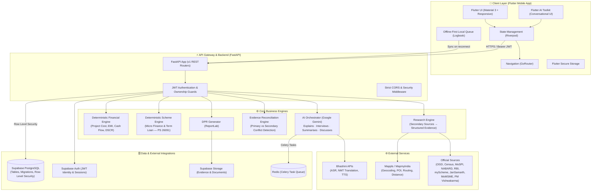
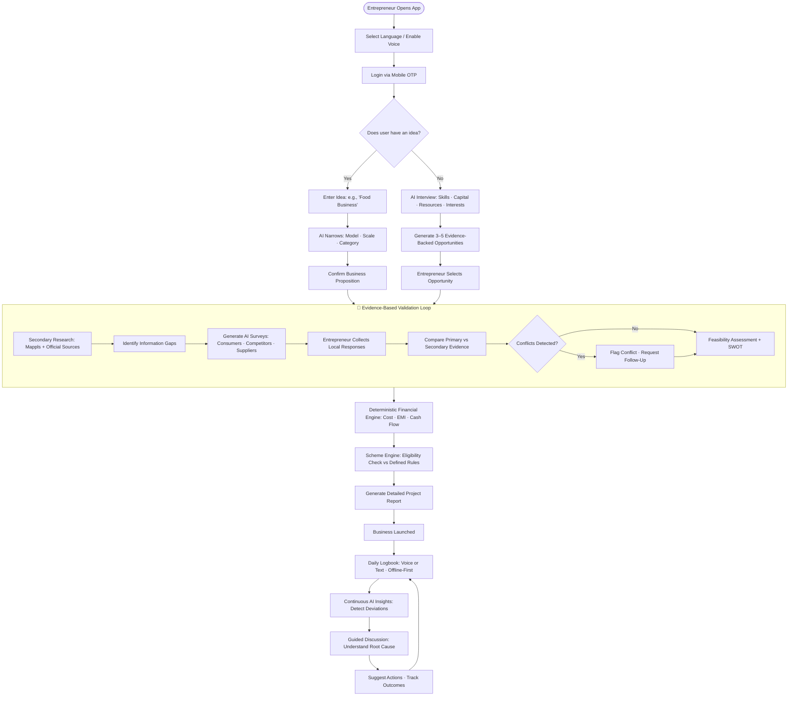

<div align="center">

# 🌾 VYAPAR MITRA (व्यापार मित्र)
### Full-Lifecycle Evidence-Based Business Advisory & Smart Financial Calculator for Rural Micro-Entrepreneurs

**Smart India Hackathon (SIH) — Problem Statement ID: 26091**

[](https://flutter.dev)
[](https://fastapi.tiangolo.com)
[](https://www.python.org)
[](https://supabase.com)
[](https://deepmind.google/technologies/gemini/)
[](https://bhashini.gov.in)
[](https://www.mappls.com)
[](https://opensource.org/licenses/MIT)

<p align="center">
  <a href="#-quick-links">Quick Links</a> •
  <a href="#-the-problem--core-philosophy">Philosophy</a> •
  <a href="#-the-complete-journey">Journey</a> •
  <a href="#-key-features">Key Features</a> •
  <a href="#-system-architecture">Architecture</a> •
  <a href="#-repository-structure">Repository</a> •
  <a href="#-getting-started">Quickstart</a> •
  <a href="#-testing">Testing</a> •
  <a href="#-documentation-index">Docs</a>
</p>

---

</div>

## 🔗 Quick Links

| Resource | Link | Description |
| :--- | :--- | :--- |
| 📱 **Mobile APK** | [Download Release APK](https://github.com/S-H-R-I-A-N-S-H/VYAPAR-MITRA/releases/latest) | Latest Android build for field trials |
| 🎬 **Video Walkthrough** | [Watch 3-Minute Demo Video](https://youtu.be/placeholder-vm-demo) | Comprehensive walkthrough of rural user onboarding & validation |
| 📊 **Pitch Deck** | [View SIH Presentation Deck (PDF)](./docs/presentation/SIH_26091_VyaparMitra_Deck.pdf) | Executive deck covering business model, technology & rural impact |
| 📑 **API Documentation** | [Swagger / OpenAPI Docs](http://localhost:8000/docs) | Interactive API exploration running on local FastAPI server |
| 📖 **Idea description** | [`docs/VISION.md`](./docs/VISION.md) | Canonical reference for all product and technical decisions |
| 📋 **Executive Summary** | [`docs/SUMMARY.md`](./docs/SUMMARY.md) | Concise product overview and MVP scope |

---

## 💡 The Problem & Core Philosophy

### The Reality of India's Micro-Enterprise Ecosystem

India has **7.92 crore unincorporated non-agricultural establishments** employing approximately **12.81 crore workers** (Annual Survey of Unincorporated Sector Enterprises, 2025). The share of establishments using the internet has grown from 26.7% to 39.4% — representing a massive, growing opportunity for digital business support.

Yet the challenge for a first-time rural or semi-urban entrepreneur is not simply the absence of capital or government schemes. The larger problem is the **absence of accessible, localized, and understandable decision support** before and after starting a business.

A first-time entrepreneur may separately need to:
- Find and validate a business idea for their specific locality
- Research local competitors, suppliers, and customer segments
- Estimate project cost and understand financing requirements
- Identify applicable government schemes and understand eligibility
- Prepare a Detailed Project Report (DPR)
- Record and analyse business performance after launch

### The Gap in Existing Government Platforms

India already has useful government platforms, but each solves a specific part of the problem:

| Platform | Purpose | What's Missing |
| :--- | :--- | :--- |
| **myScheme** | Scheme discovery & eligibility | Not a complete business feasibility workflow |
| **JanSamarth** | Credit-linked scheme discovery | No market validation, DPR generation, or post-launch monitoring |
| **CHAMPIONS** | Grievance resolution & advisory | Not a continuous workflow from discovery → DPR → monitoring |
| **Udyam Registration** | Digital enterprise registration | Does not validate local suitability or provide ongoing assistance |

A NITI Aayog report on convergence of schemes identifies that MSME-related information is distributed across MyMSME, NSWS, myScheme, and Udyam Registration — **the entrepreneur still has to connect these pieces themselves.**

### The Vyapar Mitra Principle: AI Explains, Deterministic Code Decides

```
   ❌ GENERIC CHATBOT APPROACH
   User Prompt ──▶ Large Language Model ──▶ Unverified, Hallucinated Business Report

   ✅ VYAPAR MITRA EVIDENCE ENGINE
   Entrepreneur Profile
          +
   Secondary Research ──▶ Primary Ground Surveys ──▶ Evidence Reconciliation
                                                              │
   Deterministic Financial Engine ◀──────────────────────────┘
          +
   Rules-Based Scheme Engine ──▶ Explainable, Traceable, Auditable Recommendations
```

Vyapar Mitra **strictly separates AI reasoning from deterministic computation**:
1. **AI explains and interprets** — language understanding, interview flow, research summarisation, conflict explanation, continuous business discussions
2. **Deterministic code calculates and decides** — EMIs, repayment schedules, cash flow, scheme eligibility — same input always produces the same output
3. **Evidence is reconciled, not combined** — when secondary research conflicts with primary local data, the system identifies the conflict and requests validation before capital is committed

---

## 🛤️ The Complete Journey

```
Understand → Discover → Validate → Finance → Plan → Start → Record → Identify → Discuss → Improve → Learn → Comply → Grow
```

| Stage | What Happens |
| :--- | :--- |
| **Understand** | AI-assisted interview collects entrepreneur profile, location, capital, skills, interests |
| **Discover** | 3–5 evidence-backed business opportunities identified (or existing idea clarified) |
| **Validate** | Hyper-local secondary research + AI-generated primary surveys via local network |
| **Finance** | Deterministic engine calculates project cost, financing requirement, EMI, cash flow |
| **Plan** | Scheme engine checks defined eligibility; feasibility + SWOT analysis produced |
| **DPR** | Automated Detailed Project Report generated — one structured document |
| **Record** | Offline-first voice-enabled digital logbook captures daily sales, expenses, observations |
| **Identify** | Continuous AI insights detect deviations from planned performance |
| **Discuss** | Guided entrepreneur discussion to understand the root cause of issues |
| **Improve** | Possible actions suggested; outcomes tracked over time |
| **Learn** | *(Post-MVP)* Business-specific knowledge layer with actionable summaries |
| **Comply** | *(Post-MVP)* GST, ITR, and tax compliance guidance |
| **Grow** | System remains useful throughout the full entrepreneur lifecycle |

---

## ✨ Key Features

### 🎙️ 1. Multilingual Voice-First Interaction
- Powered by **Bhashini** (National Language Translation Mission) and **Flutter AI Toolkit**
- Full voice-in, voice-out interaction in supported Indian languages
- Used throughout the product — interview, surveys, logbook, insights, and discussions
- Designed for entrepreneurs who may be uncomfortable with extensive English typing

### 🧭 2. Dual Starting States
- **Has an Idea**: Narrows broad concepts (e.g., "food business") into a clearly defined, researchable business proposition (e.g., home-based tiffin service targeting office workers)
- **No Idea Yet**: Combines entrepreneur profile with location-based research to generate 3–5 evidence-backed opportunities with supporting rationale

### 🗺️ 3. Hyper-Local Research + Primary Surveys
- **Mappls** geospatial APIs for competitor density, supplier locations, route distances, and transport cost estimation
- Secondary research from defined government and official sources (OGD Platform, Census, MoSPI, NABARD, RBI, myScheme, JanSamarth, MoMSME, PM Vishwakarma)
- AI-generated targeted surveys for consumers, competitors, suppliers, and retailers — collected via voice, form, or direct entry through the entrepreneur's local network
- Online research is **not** treated as direct village-level demand data — local demand requires primary validation

### ⚖️ 4. Evidence Conflict Detection
- Primary evidence (local surveys) and secondary evidence (online research) are compared — not simply combined
- Conflicts are surfaced transparently with explanation and targeted follow-up questions
- The entrepreneur can proceed with unresolved conflicts; conflicts are noted in the final DPR
- Information gap lists are maintained — incomplete evidence is treated as incomplete, not as confirmed fact

### 💰 5. Deterministic Financial Engine & Scheme Matching
Financial structuring answers the questions that actually matter:
- Does the entrepreneur meet the defined eligibility conditions?
- How much financing is actually required?
- How much can realistically be repaid within the chosen tenure?

**Financing rules from PS 26091 (implemented in the Scheme Engine):**

| Scheme | Project Cost | Max Financing | Interest | Tenure |
| :--- | :--- | :--- | :--- | :--- |
| Micro Finance Scheme | Up to ₹1.40 lakh | 90% (max ₹1.25 lakh) | 6.5% | 3 years + 3-month moratorium |
| Term Loan Scheme | ₹1.40 lakh – ₹50 lakh | 90% (max ₹45 lakh) | 8% | 7 years + 6-month moratorium |

> The system reports whether available information satisfies defined conditions. It **does not promise loan sanction** — final approval remains with the relevant financial institution or authority.

Repayment is evaluated against projected business cash flow so the entrepreneur understands whether borrowing is financially manageable **before** taking on the debt.

### 📋 6. Automated Detailed Project Report (DPR)
One structured document consolidating:
- Entrepreneur profile and business concept
- Market research, competitor and supplier information
- Primary and secondary research findings and evidence conflicts
- SWOT analysis and feasibility assessment
- Project cost, contribution, funding requirement
- Revenue assumptions, operating costs, repayment schedule
- Relevant scheme information and risks

### 📒 7. Offline-First Digital Logbook
- Voice-enabled logging — "Today I sold 25 packets at ₹40 each and spent ₹500 on raw material" becomes structured records automatically
- Offline-first: entries stored locally when connectivity is unavailable, synchronised when connectivity returns
- Becomes the structured data source for continuous AI insights

### 📈 8. Continuous AI Business Insights
The continuous loop — **part of the MVP, not a post-MVP feature**:

```
Record → Detect → Discuss → Understand → Act → Observe → Improve
```

- Compares logbook records against the original business plan and historical performance
- Identifies meaningful deviations and emerging issues
- Discusses identified issues through guided questions — the entrepreneur's context drives the analysis
- Suggests practical actions and tracks whether the situation improves over time

---

## 🏗️ System Architecture

Vyapar Mitra uses a clean, layered architecture ensuring robust separation of concerns, high testability, and enterprise-grade security.



---

## 🛤️ User Journey Flow



---

## 📂 Repository Structure

```text
vyapar-mitra/
├── lib/                             # 📱 Flutter Mobile Application Root
│   ├── main.dart                    # Application entry point
│   ├── app/                         # App configuration, routing & lifecycle
│   ├── core/                        # Theme, typography, constants & network client
│   │   ├── theme/                   # High-contrast, accessible rural color palette
│   │   └── utils/                   # Shared formatters (INR currency, dates)
│   ├── features/                    # Feature modules (Domain-driven architecture)
│   │   ├── onboarding/              # Language selection & phone auth
│   │   ├── interview/               # Conversational voice/text interview
│   │   ├── opportunities/           # Opportunity discovery (State B)
│   │   ├── business/                # Business model management & state
│   │   ├── research/                # Secondary market intelligence
│   │   ├── evidence/                # Primary ground surveys & reconciliation
│   │   ├── finance/                 # Financial feasibility & calculator views
│   │   ├── dpr/                     # DPR generation & access
│   │   ├── logbook/                 # Offline-first digital logbook
│   │   ├── insights/                # Continuous AI insights & deviation tracking
│   │   ├── recommendations/         # Traceable advice & action roadmap
│   │   └── profile/                 # Entrepreneur profile & location preferences
│   └── shared/                      # Reusable widgets (cards, badges, dialogs)
│
├── backend/                         # ⚡ FastAPI Modular Monolith
│   ├── app/
│   │   ├── main.py                  # FastAPI application & middleware configuration
│   │   ├── core/                    # Config, security, database & error handlers
│   │   ├── schemas/                 # Strict Pydantic v2 validation models
│   │   ├── services/                # Business logic services
│   │   │   ├── financial_engine.py  # Deterministic financial computations
│   │   │   ├── scheme_engine.py     # Deterministic scheme eligibility (PS 26091 rules)
│   │   │   ├── research_engine.py   # Secondary research pipeline
│   │   │   ├── evidence_service.py  # Research synthesis & conflict reconciliation
│   │   │   ├── dpr_service.py       # DPR generation (ReportLab)
│   │   │   └── ai_service.py        # Gemini AI structured orchestration
│   │   ├── adapters/                # Pluggable external adapters
│   │   │   ├── bhashini.py          # Bhashini ASR/TTS with sandbox fallback
│   │   │   └── mappls.py            # Mappls Geospatial with mock fallback
│   │   └── api/v1/                  # Versioned API routes
│   │       ├── endpoints/           # Clean modular route handlers
│   │       └── router.py            # Consolidated v1 router
│   ├── tests/                       # Pytest automated test suite
│   ├── requirements.txt             # Python dependencies
│   └── README.md                    # Dedicated backend documentation
│
├── supabase/                        # 🗄️ Database & Backend-as-a-Service
│   └── migrations/                  # Version-controlled SQL DDL & RLS policies
│
├── docs/                            # 📚 Architecture, Product Specs & Reference
│   ├── VISION.md                    # ⭐ Canonical product bible — all decisions reference this
│   ├── SUMMARY.md                   # Executive summary & MVP scope overview
│   ├── product.md                   # Product definition & SIH MVP requirements
│   ├── architecture.md              # Technical architecture & subsystem boundaries
│   ├── api-contracts.md             # REST API contracts & Pydantic schemas
│   ├── database.md                  # Relational schema & RLS security design
│   ├── ai-behaviour.md              # Prompt engineering, schemas & hallucination control
│   ├── security.md                  # Auth, secrets, sanitization & compliance
│   ├── ux.md                        # Multilingual, low-literacy UX guidelines
│   ├── testing.md                   # Automated testing strategy (backend + mobile)
│   └── development.md               # Developer workflow, coding standards & CI
│
├── assets/                          # Static assets (i18n catalogs, icons, logos)
├── pubspec.yaml                     # Flutter dependency manifest
├── analysis_options.yaml            # Dart static analysis configuration
├── .env.example                     # Environment configuration template
└── README.md                        # This project presentation & developer guide
```

---

## 🚀 Getting Started

### Prerequisites

Ensure you have the following installed on your development machine:
- **Flutter SDK** (`^3.13.3` or later) & **Dart SDK** (`^3.1.0` or later) — [Install Flutter](https://docs.flutter.dev/get-started/install)
- **Python** (`3.11` or `3.12`) — [Install Python](https://www.python.org/downloads/)
- **Android Studio** or **VS Code** with Flutter & Dart extensions
- **Git**

---

### Step 1: Clone the Repository

```bash
git clone https://github.com/S-H-R-I-A-N-S-H/VYAPAR-MITRA.git
cd vyapar-mitra
```

---

### Step 2: Configure Environment Variables

Create your local `.env` configuration by copying the provided template:

```bash
# On Linux / macOS
cp .env.example .env

# On Windows (PowerShell)
Copy-Item .env.example .env
```

Open `.env` in your editor and configure:

| Key | Required | Default / Fallback | Description |
| :--- | :---: | :--- | :--- |
| `ENVIRONMENT` | Yes | `development` | Server runtime environment (`development` / `production`) |
| `PORT` | Yes | `8000` | Port for the FastAPI server |
| `SUPABASE_URL` | Yes | - | URL of your Supabase project instance |
| `SUPABASE_KEY` | Yes | - | Public anon key for client-side queries |
| `SUPABASE_SERVICE_ROLE_KEY` | Yes | - | Service role key for backend elevated operations |
| `SUPABASE_JWT_SECRET` | Yes | - | Secret key used to verify Supabase JWT auth tokens |
| `GEMINI_API_KEY` | Yes | - | Google Gemini API key for conversational AI |
| `GEMINI_MODEL` | No | `gemini-2.0-flash` | Gemini model variant |
| `BHASHINI_API_KEY` | No | *Sandbox Fallback* | Bhashini AI credentials (falls back to mock if blank) |
| `MAPPLS_CLIENT_ID` | No | *Sandbox Fallback* | MapmyIndia credentials (falls back to mock if blank) |

> [!NOTE]
> The backend includes built-in mock and sandbox adapters for **Bhashini** and **Mappls**. You can run and test the complete system locally even without active external enterprise API keys.

---

### Step 3: Run the FastAPI Backend

Open a terminal window:

```bash
# 1. Navigate to the backend directory
cd backend

# 2. Create and activate a Python virtual environment
# Windows (PowerShell):
python -m venv .venv
.\.venv\Scripts\Activate.ps1

# Linux / macOS:
# python3 -m venv .venv
# source .venv/bin/activate

# 3. Install backend dependencies
pip install -r requirements.txt

# 4. Start the FastAPI development server with hot-reload
uvicorn app.main:app --reload --port 8000
```

Verify that the server is active:
- Open your browser to `http://localhost:8000/docs` to view the interactive Swagger documentation.
- Healthcheck endpoint: `http://localhost:8000/api/v1/health`

---

### Step 4: Run the Flutter Mobile Application

Open a second terminal window in the root directory:

```bash
# 1. Ensure you are in the project root
cd ..

# 2. Fetch Flutter packages
flutter pub get

# 3. Verify Flutter environment setup
flutter doctor

# 4. Launch the app on an Android emulator, connected phone, or Chrome
flutter run
```

---

## 🧪 Testing & Quality Assurance

Vyapar Mitra adopts a strict **Test-Driven Development (TDD)** approach. Deterministic engines — financial calculations and scheme eligibility rules — must pass 100% of automated unit and boundary tests.

### Backend Test Suite (FastAPI + Pytest)

```bash
# From the backend directory with .venv activated:
cd backend
pytest -v
```

Tests validate:
- EMI and loan amortization calculations
- Project cost, margin contribution, and financing calculations
- Micro Finance Scheme vs Term Loan Scheme threshold routing (PS 26091 rules)
- Repayment affordability against projected cash flow
- Survey conflict detection and evidence reconciliation
- Financial engine determinism — same inputs must always produce identical outputs

### Frontend Static Analysis & Widget Tests (Flutter)

```bash
# From the repository root:
flutter analyze --no-fatal-infos
flutter test
```

---

## 🔐 Security & Data Governance

- **Zero Hardcoded Secrets**: Credentials are exclusively injected via environment variables and never tracked in git (enforced via `.gitignore`)
- **Server-Enforced Authorization**: All sensitive operations verify caller identity using Supabase JWT tokens; client-side checks are UX conveniences only
- **Row-Level Security (RLS)**: PostgreSQL tables are locked with tenant-isolated RLS policies, preventing unauthorized cross-user data access
- **Input Sanitization**: All user payloads pass through strict Pydantic schemas before reaching AI prompts or database queries
- **Minimum Data Collection**: Only information required for the selected workflow is collected
- **AI/Deterministic Separation**: Financial calculations and scheme outputs retain their input information and rule source for full auditability
- **Scheme Results Disclaimer**: The system reports eligibility against defined conditions. It never presents scheme eligibility as a guarantee of government or lender approval

---

## 📚 Documentation Index

For deep technical insights, refer to the documentation suite in [`docs/`](./docs):

- ⭐ [**Idea Description (`docs/VISION.md`)**](./docs/VISION.md) — Canonical reference for all product and technical decisions
- 📋 [**Executive Summary (`docs/SUMMARY.md`)**](./docs/SUMMARY.md) — Concise product overview, MVP scope, and roadmap
- 🎯 [**Product Definition (`docs/product.md`)**](./docs/product.md) — Problem statement, target personas, MVP scope, and deferred features
- 🏛️ [**System Architecture (`docs/architecture.md`)**](./docs/architecture.md) — Component responsibilities, boundary rules, and sequence flows
- 🔌 [**API Contracts (`docs/api-contracts.md`)**](./docs/api-contracts.md) — Exhaustive REST endpoints, request/response models, and error codes
- 🗄️ [**Database Schema (`docs/database.md`)**](./docs/database.md) — Tables, relations, indexes, and Row Level Security policies
- 🤖 [**AI Behaviour & Prompts (`docs/ai-behaviour.md`)**](./docs/ai-behaviour.md) — Structured prompting, JSON schemas, and hallucination safeguards
- 🔒 [**Security & Compliance (`docs/security.md`)**](./docs/security.md) — Authentication flow, key management, and data protection standards
- 🎨 [**UX & Voice Guidelines (`docs/ux.md`)**](./docs/ux.md) — Multilingual conversational design for low-literacy rural entrepreneurs
- 🧪 [**Testing Strategy (`docs/testing.md`)**](./docs/testing.md) — TDD protocols, boundary test cases, and CI integration
- 🛠️ [**Development Guide (`docs/development.md`)**](./docs/development.md) — Git workflows, branching conventions, and coding guidelines

---

## 👥 Team & Acknowledgements

Developed with pride for the **Smart India Hackathon (SIH)**. We express our gratitude to:
- **Ministry of Micro, Small and Medium Enterprises (MSME)** for scheme guidelines and public data APIs
- **Bhashini (Digital India Mission)** for open multilingual speech recognition and translation services
- **MapmyIndia (Mappls)** for enabling hyper-local geospatial discovery across rural India
- **Open Government Data Platform India**, **Census of India**, **MoSPI**, **NABARD**, **Reserve Bank of India**, **JanSamarth**, **myScheme**, and **PM Vishwakarma** for official data sources

---

## 📄 License

This project is licensed under the [MIT License](LICENSE) — see the [LICENSE](LICENSE) file for details.
